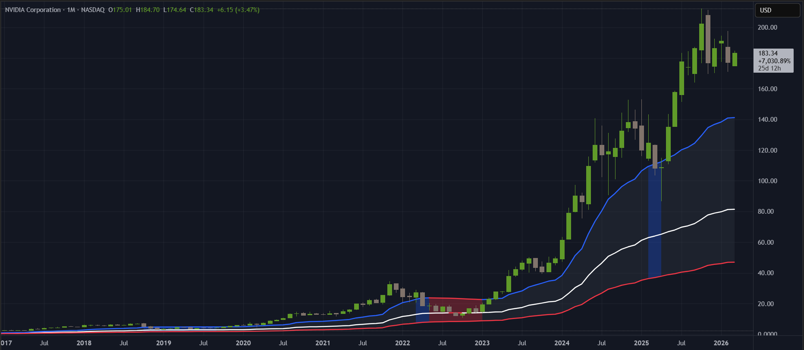
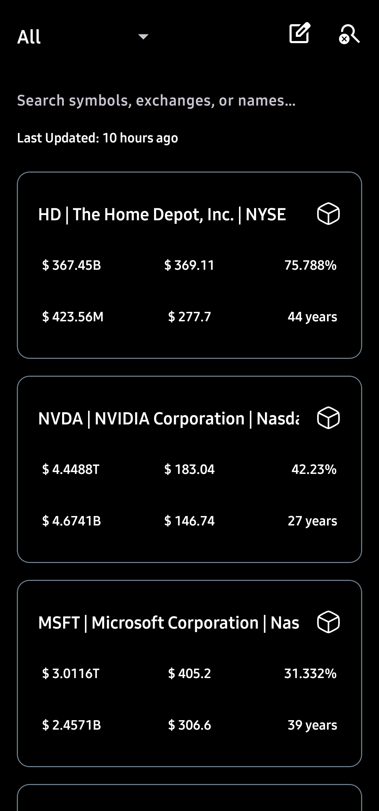
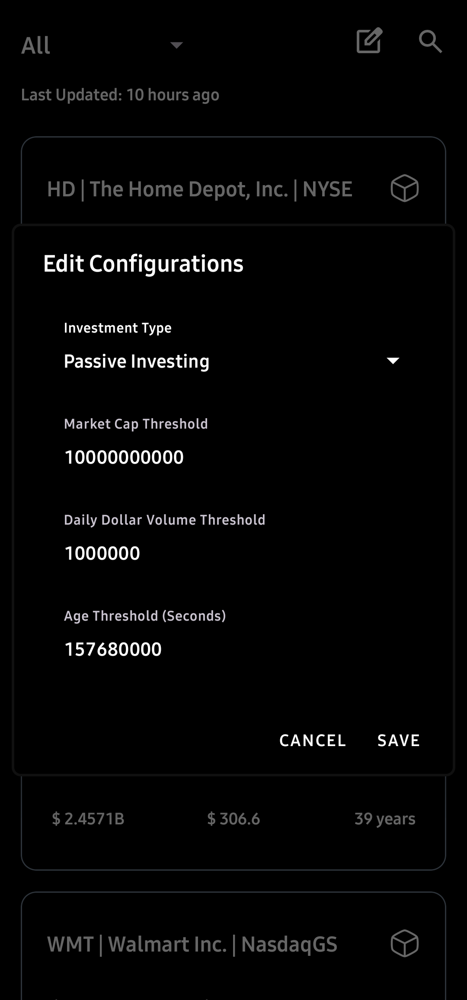
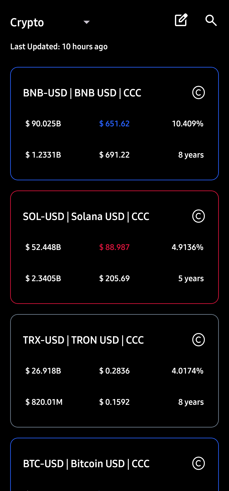

# 📊 Investment Screener
> A system that automatically pulls the price history of every large-cap stock and cryptocurrency, runs proprietary signal math on that history, allowing real-time notification for investment opportunities.

---

## What Data Is Collected

Every refresh cycle pulls two types of assets from Yahoo Finance:

| Asset Class | Universe | Ranked by |
|---|---|---|
| **US Stocks** | All large-cap US equities | Market cap (largest first) |
| **Crypto** | All US-listed cryptocurrencies | Market cap (largest first) |

**Fields collected per price bar:**

| Data Point | What It Represents |
|---|---|
| Open price | Price at the start of the bar |
| High price | Highest price reached during the bar |
| Low price | Lowest price reached during the bar |
| Close price | Price at the end of the bar |
| Adjusted close | Close price corrected for stock splits and dividends |
| Volume | Number of units traded (crypto volume is converted from dollar value back to units) |
| Market cap | Total market value of the asset — used for filtering |
| First trade date | Inferred from the earliest timestamp in the history |

**Time intervals fetched** (tried in order, first one that returns data is used):

| Interval | Bar length |
|---|---|
| Daily | 1 trading day per bar |
| Weekly | 1 week per bar |
| Monthly | 1 month per bar |
| Quarterly | 3 months per bar |

---

## Signals Computed From the Raw Data

### Fair Value Price

Rather than using the most recent close as the reference price, the app computes a **volume-weighted, range-weighted average** across the asset's entire history. Bars where more money changed hands — and where price moved across a wider range — carry more weight.

This produces a single price level representing where the bulk of all trading activity has historically concentrated. It adjusts automatically as new bars arrive.

### Upper and Lower Bands

Using the same historical data, the app measures how far price has typically strayed from the fair value price — again weighted by traded volume and bar width. This produces a symmetric upper band and lower band around fair value.

These bands are not fixed percentages. They widen for volatile assets with erratic price history and narrow for stable ones. They also adapt as new price data comes in.

### Price State — The Core Signal

Every asset is classified into one of three states at any moment:

| State | Condition | Interpretation |
|---|---|---|
| 🟢 **Above Range** | Current price is above the upper band, and the growth rate is positive | Price has cleared its historical resistance ceiling with upward momentum |
| 🟡 **In Range** | Current price sits between the lower and upper band | Price is within fair value — neither cheap nor stretched |
| 🔴 **Below Range** | Current price is below the lower band, or growth rate is zero/negative | Price is below where most historical trading occurred, or the trend is flat/declining |

### Growth Rate (% per day)

Measures how much the asset has returned from a contextual starting point to today, normalised to a daily rate so assets of any age can be compared on the same scale.

Two modes use different starting points:

| Mode | Starting Point | Measures |
|---|---|---|
| **Passive** | The asset's very first trading day (IPO / launch) | Total lifetime return per day |
| **Momentum** | The last point where the upper band stopped making new highs | Return since the current trend began |

### Average Daily Dollar Volume

A liquidity measure — the average dollar value traded per day, calculated from the full price history and normalised to daily terms regardless of which interval (weekly, monthly, etc.) was used. Used to filter out assets that would be difficult to enter or exit without moving the market.

---

## Filters Applied Before Surfacing Results

| Filter | Default | What Gets Excluded |
|---|---|---|
| **Minimum market cap** | $10 billion | Small and mid-cap assets |
| **Minimum daily dollar volume** | $1 million / day | Illiquid assets |
| **Minimum asset age** | 5 years | Assets without enough history for reliable signals |

All three thresholds are adjustable by the user in the app's settings dialog.

---

## How Data Stays Fresh

Each cached signal record tracks the timestamp of the last bar it processed. On incremental refreshes, the API is asked only for bars newer than that timestamp. The running totals used in the signal math are updated by appending new bars, not by recalculating from scratch.

A background worker re-runs this update automatically on a schedule. If the app detects that data has gone stale beyond the thresholds below, the user is notified:

| Bar Interval | Considered Stale After |
|---|---|
| Daily bars | 2 days |
| Weekly bars | 14 days |
| Monthly bars | ~62 days |
| Quarterly bars | ~184 days |

---

## Investment Strategy Modes

| Mode | What Gets Ranked | Best For |
|---|---|---|
| **Passive** | Assets with the highest lifetime return per day since first trade | Long-term, buy-and-hold selection |
| **Momentum** | Assets with the highest return per day since their most recent trend started | Shorter-term, trend-following selection |

The top 4 assets under each mode are saved as the active watchlist and drive all alert logic.

---

## Android Application Preview

  
  
  

